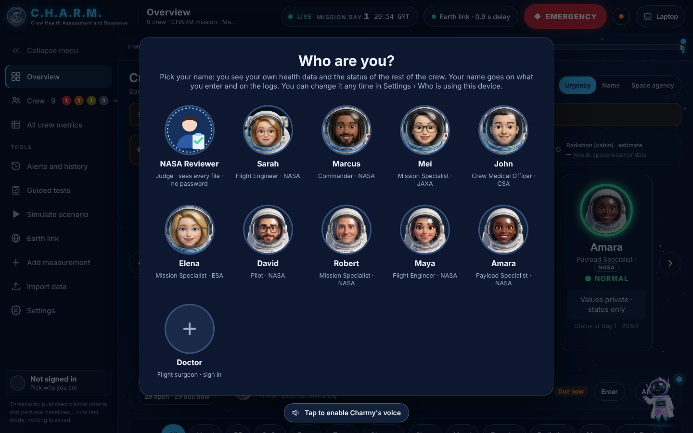
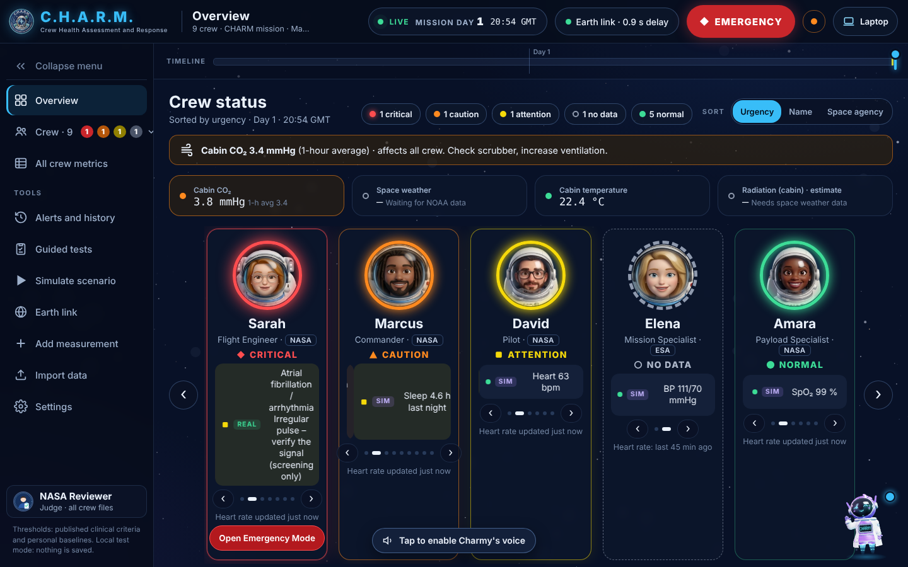
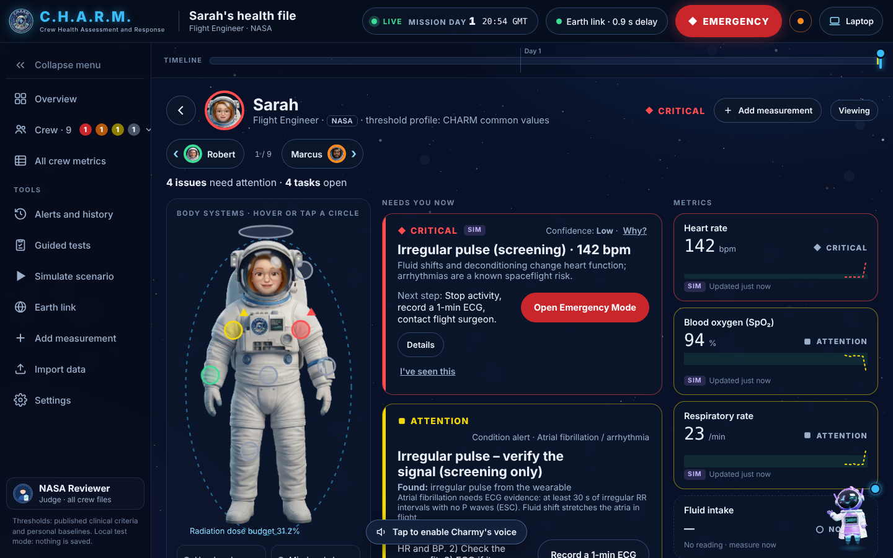
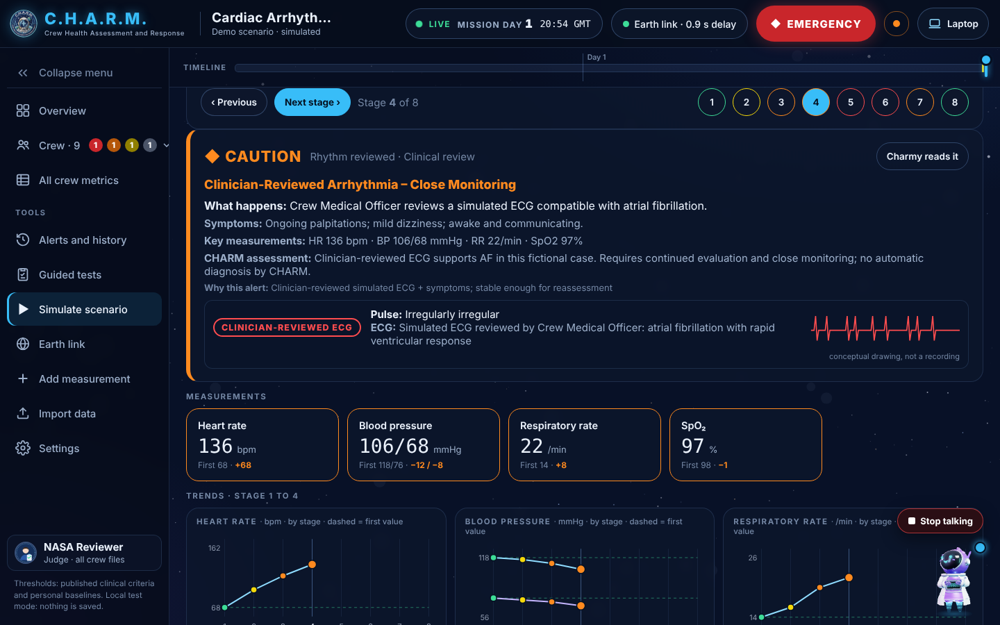
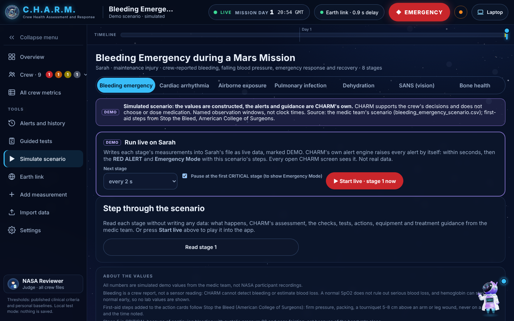
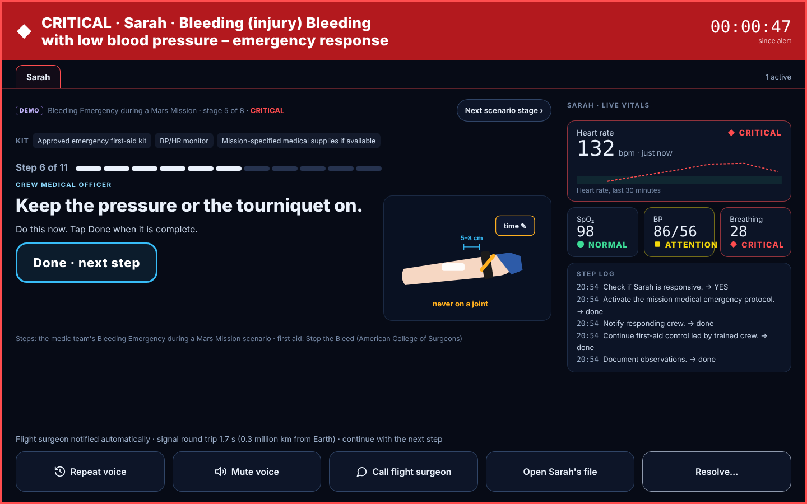
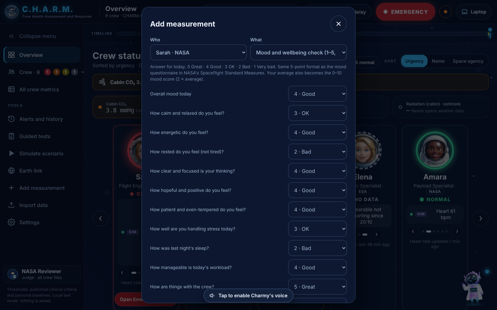
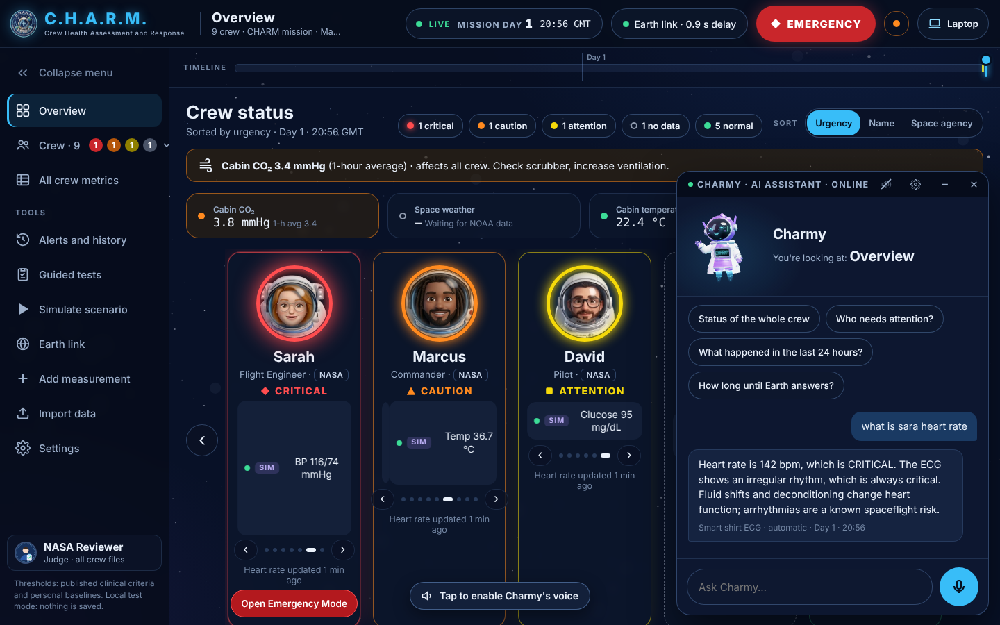
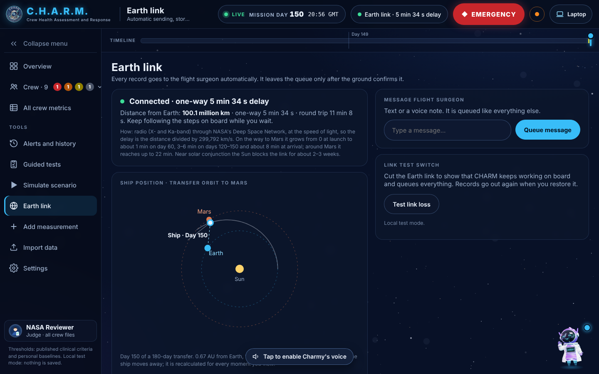

# C.H.A.R.M. live app (Firebase)

Crew Health Assessment and Response Module, NASA Space Apps 2026.
This is the live version: real data on a server, with no simulated data built in.

## A quick tour (screenshots)
All screenshots are from the app itself (local test mode, demo data loaded). Click one to see it full size.

| | |
|---|---|
|  **1. Who are you?** Each astronaut picks their name. NASA Reviewer (for the judges) is first; the doctor signs in. |  **2. Overview.** Every crew member as a card, sorted by urgency, with colour + word + shape status and the cabin readings (CO₂, space weather, temperature) on top. |
|  **3. Astronaut file.** One tile per measurement with its level, trend and source (REAL / SIM), and why CHARM raised each alert. |  **4. A scenario stage.** The alert title and why, the ECG evidence, the trend charts and what the crew should do now. |
|  **5. Simulate scenario.** Seven medic-team scenarios. **Run live** writes each stage into Sarah's file every 2 s, and CHARM's engine raises the alerts itself. |  **6. Emergency Mode.** Opens by itself at CRITICAL: one illustrated, spoken screen per Crew Medical Officer action. |
|  **7. Mood and wellbeing check.** 14 questions on a 1–5 scale plus free notes. |  **8. Charmy.** The AI assistant answers typed or spoken questions about the crew's data. |
|  **9. Earth link.** The real light-time delay for today's mission day, the ship's position on the Mars transfer, and the outbox that keeps working when the link is down. | |

## What runs where

| Part | Where | What it does |
|---|---|---|
| Web app | Firebase Hosting (`public/`) | The C.H.A.R.M. interface. It reads live data from Firestore and works offline from its local copy. |
| `api` | Cloud Function (callable) | Handles every write: measurements, guided tests, CSV import, thresholds, crew, mission, messages, demo scenario. It checks each value against plausible ranges and updates alert status. |
| `tick` | Cloud Function (every 5 min) | Clears alerts after 3 checks back in range, flags silent wearables, raises cabin CO₂ and radiation alerts, moves the Earth outbox, and pulls real space weather from NOAA SWPC (GOES ≥10 MeV protons). |
| Database | Firestore | Collections: `crew`, `mission`, `overrides`, `readings`, `env`, `status`, `events`, `outbox`, `inbox`. All data is append-only. |

The server logic lives in `shared/engine.js` and `shared/core.js`. The browser uses the same files, so the levels on screen match the server exactly. **Edit them only in `shared/`.** On each deploy, `tools/sync-shared.js` copies them into `functions/` and `public/js/`.

## Starting state
- Nine crew profiles are created on first start: Sarah, Marcus, Mei, John, Elena, David, Robert, Maya and Amara (name, agency, role and photo). If the database already exists, the next start (or the 5-minute server check) adds any missing ones.
- There are **no health readings**. To get data in, use one of these:
  - **Add measurement** (left menu, the astronaut file, or each metric page)
  - **Guided tests** (blood pressure, glucose, ECG, reaction time)
  - **Import data** (CSV templates for NASA, ESA, JAXA and CSA in `public/assets/templates/`)
  - **Simulate scenario** (side panel) runs one of the seven medic-team scenarios live.
  - **Settings › Demo tools › Load 3 hours of demo history** (for the judges' demo). It writes about 3 hours of readings tagged `DEMO`:
    - Sarah: irregular rhythm, CRITICAL
    - Marcus: short sleep, CAUTION
    - Elena: wearable silent, NO DATA
    - Cabin CO₂ rising

## Laptop / tablet view
The **Laptop / Tablet** button at the right of the top bar switches between laptop and tablet view. Tablet view has bigger touch targets, a collapsed menu and fewer cards per row. The choice is saved on the device. On a touch screen narrower than 1400 px, tablet view turns on automatically.

## Alert scenarios (team table, 15.11)
`data/reference/charm_alert_scenarios.csv` is the team's scenario table. WATCH = ATTENTION (yellow), ALERT = CAUTION (orange), CRITICAL = CRITICAL (red). Implemented in `shared/engine.js`:
| # | Scenario | ATTENTION | CAUTION | CRITICAL |
|---|---|---|---|---|
| 1 | Dizziness on standing (`c_orth`) | HR +30 on standing without a BP drop; body mass down > 2 % or fluids < 2.5 L/day | drop ≥ 20 / 10 mmHg within 3 min | standing systolic ≤ 90, or fainting |
| 2 | Solar radiation storm (cabin) | NOAA S1 (≥ 10 pfu) | S2 (≥ 100 pfu) | S3+ (≥ 1,000 pfu) |
| 3 | Infection (`c_inf`) | one SIRS sign, or temperature ≥ 0.8 °C above own normal | ≥ 2 SIRS signs, or temperature > 38.0 °C | qSOFA ≥ 2 (RR ≥ 22, systolic ≤ 100, new confusion) |
| 4 | Cabin CO₂ / low oxygen | CO₂ 1-h mean > 2.3 mmHg | > 3.0 mmHg | SpO₂ ≤ 91 % or RR ≥ 25 (per person) |
| 5 | Low blood sugar | – | glucose < 70 mg/dL | < 54 mg/dL |
| A | SANS self vision test (`c_sans`) | worse than before flight once | worse 2 tests in a row | (OCT / exam thresholds) |
| B | Fluid loss and space anemia (`c_anem`) | Hb up ≥ 5 % vs own first value while body mass is down > 2 % or fluids < 2.5 L/day | Hb below WHO (women 12, men 13 g/dL) or down ≥ 10 % | Hb < 8 g/dL |

Not yet: the reaction-test drop as "new confusion" in qSOFA (use the symptom check), and "in the days before landing" (the app has no landing date, so scenario 1 WATCH applies at any time). Trend rules read up to 120 days of body mass, blood counts, vision and fluids on the server (new Firestore index `pid + k + t`).

## Mood and wellbeing check
**Add measurement › Mood and wellbeing** (also the daily "mood" task) asks 14 short questions on a 1–5 scale (1 = worst, 5 = best), like the rating scales in NASA crew self-reports: overall mood, calm, energy, feeling rested, focus, hope, patience, handling stress, last night's sleep, workload, the crew, mission control, family and home, and how the body feels. A free **Notes** box keeps the astronaut's own words. The answers are saved as one `well` record, and the Mood tile gets `2 × average` (0–10). Levels (`wellStats` in `shared/engine.js`): CAUTION if the average is 2 or lower, or "hope" is 1; ATTENTION if any answer is 1, three or more answers are 2 or lower, or the average is 2.5 or lower.

## Heart rhythm: vitals give urgency, the ECG names the rhythm
Medic team note, implemented in `c_af` (`shared/engine.js`):
- A watch flag of an irregular pulse is **ATTENTION** (screening only).
- An irregular pulse with a fast heart rate or symptoms is **CAUTION**: "record a 12-lead ECG".
- An irregular, fast pulse with low blood pressure, fainting or chest pain and **no ECG yet** is **CRITICAL**: "record an ECG now".
- Only an ECG read by the medical officer names the rhythm ("compatible with atrial fibrillation"). Echocardiography can follow as a later step. Once a reviewed ECG exists, the heart-rate tile is capped at CAUTION, so the rhythm alert leads.

## Charmy voice input
Tap the microphone in Charmy's chat to start speaking and tap it again to stop and send; Charmy keeps listening through pauses. It uses the browser's own speech recognition (Web Speech API, English): Chrome, Edge and Safari, with an internet connection. Charmy matches crew names even when they are misheard slightly, reads "my / me" as the signed-in astronaut, and recognises topic words (heart rate, pressure, oxygen, sleep, mood, bleeding…).

## Demo tools (not part of the real app)
Settings › **Demo tools** is only for the video and the judges: a quick demo alert, the live demo file, 3 hours of crew demo history and the crew data library. The scenarios moved to **Simulate scenario** in the side panel. The page says so at the top, and everything it makes is marked DEMO.
- **Live demo file:** plays `data/demo/demo_sarah_red-alert.csv` as if it were live. Pick the start (default: the treadmill starts in 2 minutes, the red alert follows about 30 minutes later), the speed (1×, 2×, 5×, 10×) and the astronaut. The rows before the start point are added at once as recent history; the rest arrive at their own time, and the file repeats at the end. The server adds due rows on every 5-minute tick, and every open CHARM screen asks for them every 20 seconds. Readings are tagged `src: 'demo'` (SIM), the crew notes appear in Alerts and history, and the Overview shows a DEMO banner while it runs. **Stop** ends it.
- **Generate a demo alert:** pick an astronaut, a measurement and a level (ATTENTION / CAUTION / CRITICAL; a level the measurement does not have is greyed out). CHARM writes a value that reaches that level with that person's own limits (`demoReading` in `shared/engine.js`), then a normal value 5 minutes later, and clears the alert at once. Values are tagged `src: 'demoalert'` and show a DEMO tag; the Overview shows a DEMO ALERT banner, the red-alert list says DEMO ALERT, and the history has "DEMO ALERT generated / ended".
- **Simulate scenario (side panel):** seven scenarios from the medic team, CSVs and PDFs in `data/scenarios/` (built into `public/js/scenarios.js` by `tools/build_scenarios.py`, so they run offline), in this order: **Bleeding emergency** (8 stages; crew-reported bleeding, CRITICAL at systolic 86 with near-fainting; first-aid steps added from Stop the Bleed, American College of Surgeons), **Cardiac arrhythmia** (8; screening flag → ECG required → clinician-reviewed AF → unstable per the AHA tachyarrhythmia algorithm), **Airborne exposure / respiratory emergency** (8; air-filter seal failure, possible allergic or irritant airway reaction graded by NAEPP; stage 1 HR, BP, RR, temperature are the rounded pre-bed-rest means of NASA CFT70 ground-analog subject C11_CFT70_8072, SpO2 and later values synthetic), Pulmonary infection (8), Dehydration (10), SANS (11), Bone health (7). Each stage shows the alert title and why, a crew report panel where the scenario has one (not a sensor measurement), measurement provenance, trend charts with gaps where a stage has no values, and LAST KNOWN · STALE values during the Earth-link outage. **Run live** writes each stage into Sarah's file (op `demoStage`, `src: 'scenario'`, DEMO) and CHARM's own engine raises the alerts; Emergency Mode opens by itself the first time CHARM reaches CRITICAL, with one illustrated, spoken screen per Crew Medical Officer action. Engine rules added for the scenarios: bleeding (`c_bleed`: reported/ongoing, controlled, life-threatening), arrhythmia (`c_af`), airway reaction (`c_resp`), shock index (`c_vol`), SANS and bone markers. Known difference: in the airborne scenario CHARM's breathing-rate rule (NEWS2, 25/min or more) is CRITICAL at stage 4, one stage before the authored CRITICAL.
- State is kept in `system/demo` (not readable by the app); `mission.demoLive` `mission.demoAlerts` and `mission.demoScenario` tell the app what is running. Demo readings have fixed ids, so two screens pumping at once never store a row twice.

## Earth link delay
The ship flies a 180-day (about 6 months) transfer from Earth to Mars, launched on Mission Day 1 (`shipGeom` in `shared/engine.js`: conic transfer solved with Kepler's equation; Earth and Mars on circular orbits). The one-way delay is the Earth–ship distance divided by the speed of light, for the moment you view: about 30 s on day 30, 2 min on day 90, 5.6 min on day 150, 8 min on arrival (day 181), then it follows Mars. The Ship position card on the Earth link page draws the same path.

## Loading and the offline copy
The app keeps an offline copy in the browser (IndexedDB). If that copy is locked by another tab ("Failed to obtain primary lease"), the app reloads once after 20 s without it, for that tab. Each load reads the last 8 days of readings (about 15,000 documents now), so many reloads cost Firestore reads.

## Personal limits: the CHARM model
The team's alert model (`charm_model/`, model version charm-baseline-2.0) gives each crew member a personal band for heart rate, blood pressure, breathing rate and temperature: their own baseline from the research subject their data comes from, plus the expected change in space for **today's mission day** (from Settings › Mission). The band is in `shared/engine.js` (`MODEL` block). It only **adds** ATTENTION ("unusual for you") for a resting value outside the band. It never loosens a CHARM common limit (a systolic 155 is ATTENTION even for someone who usually runs high) and never moves a CRITICAL limit. A limit set by hand in Settings › Alert thresholds switches the band off for that metric. Rebuild the block after refitting the model:
```bash
python3 tools/build_model_profiles.py "<folder that contains charm_model>"
```
Inspiration4 crew (Marcus, Mei, Robert, Amara) have blood counts only, so their vitals use the common limits.

**Other alert rules changed on 15.11:** SpO₂ uses the NEWS2 bands (ATTENTION 94–95 %, CAUTION 92–93 %, CRITICAL ≤ 91 %). Body mass is followed as a trend: ATTENTION > 2 % lost in 14 days, CAUTION > 5 % in 30 days, CRITICAL > 10 % in 30 days.

## Alert levels
NORMAL (green) · ATTENTION (yellow, one screening limit) · CAUTION (orange, medical criterion or multi-signal condition) · CRITICAL (red, urgent). The six condition alerts and their numbers come from the medic team's `data/reference/charm_alert_rules.csv`, and the logic is in `shared/engine.js` (`conditions`, `examLevel`). New exam forms are under **Add measurement**: ECG review, orthostatic BP test, urine/kidney check, neck-vein ultrasound, eye exam, symptom check, fluid intake.

## Data (`data/`)
Real crew files (NASA bed rest, Inspiration4, CSA stream), two demo scenarios (red alert, caution), and reference tables. Import them with **Import data**. See `data/README.md` for sources, the load order (set today to Mission Day 60 first) and the personal alert limits. Rebuild them with `python3 tools/build_crew_csv.py <charm_db folder> data`.

Raw team data is in `data/raw` (Git LFS). Run `git lfs pull` after cloning.

## Startup intro (6 s)
`public/assets/intro.mp4`: the C.H.A.R.M. clip, compressed to 3.2 MB at 1080p. It plays over the app while the app loads underneath.
- **Shown** when this device has not opened CHARM in the last 8 hours. The device stores `charm-last-active` and refreshes it every 5 minutes while the app is open.
- **Not shown** when an emergency was open the last time this device ran CHARM (`charm-emergency-open`), or when the device has reduced motion turned on.
- **Closes at once** if an emergency opens while it plays: a crew member goes CRITICAL or Emergency Mode starts.
- Starts with sound. If the browser blocks autoplay with sound (usually on a first visit, before any click on the site), it plays muted instead and shows **Sound on**. Skip with **Skip**, a tap anywhere, Escape or Enter. It never blocks the app for more than 12 s.
- Testing: `?intro=1` always shows it; `?nointro` never shows it.

## Deploy (first time)
Run these in WSL, in this folder:

1. In the Firebase console, open project **charm-b9fd1** and upgrade to the **Blaze** plan. Cloud Functions need Blaze; your Google Cloud credit pays for it.
2. In the console, go to **Firestore Database › Create database**. Choose production mode and region `us-central1` (or `nam5`).
3. Install and log in:
   ```bash
   cd functions && npm install && cd ..
   firebase login          # sign in with charm.nasa@gmail.com
   ```
4. Deploy everything:
   ```bash
   firebase deploy
   ```
   This uploads hosting, both functions, the Firestore rules and the indexes. The first deploy takes a few minutes and may ask to enable APIs; answer **y**.
5. Open `https://charm-b9fd1.web.app`. The crew appears within a few seconds.

Later updates: `firebase deploy`, or `firebase deploy --only hosting` if you changed only the web app.

## Test without Firebase
```bash
cd public && python3 -m http.server 8000
# open http://localhost:8000/index.html?backend=local
```
`?backend=local` runs the same server code inside the browser, with memory storage. Nothing is saved. Use it for screenshots and the video.

`?emulator` connects to the Firebase emulators (`firebase emulators:start`).

## Rebuild the Firebase browser bundle (rarely needed)
`cd tools && npm install && npm run build` writes `public/js/firebase.js`. Deploying does not need this; the built file is included.

## Server tests
`node --test test/core.test.js`

## Who sees what
- **Astronauts** pick their name in **Who are you?** (no password). They see their own data, and only the status (colour + word) of the rest of the crew: values, charts, history and Charmy's answers about other people are hidden.
- **NASA Reviewer** (first in **Who are you?**, for the judges): no password, sees every file, cannot change alert thresholds.
- **Doctor:** pick **Doctor** and sign in with user name `doctor` and the team password. The doctor (flight surgeon) sees every file and is the only one who can change alert thresholds. The sign-in lasts until the browser is closed.
- **Emergency:** when a crew member is CRITICAL, their file opens for the crew, and every opening is logged.
- There is no shared display (removed 15.11): everyone signs in as themselves or as the doctor.
- **Private file message:** opening someone else's file shows a message; **I am … / the doctor · sign in** lets the right person sign in and goes straight on to the file.
- The red **EMERGENCY** button in the top bar appears only while a crew member is CRITICAL or an emergency is open.
